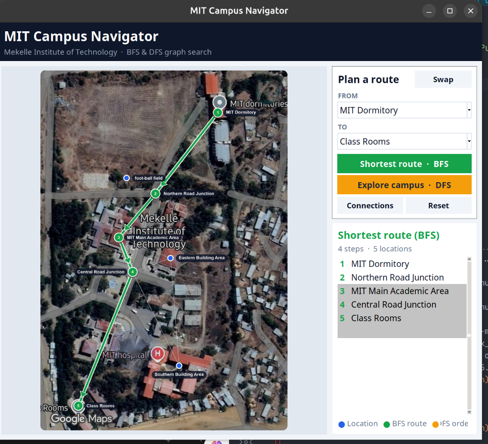
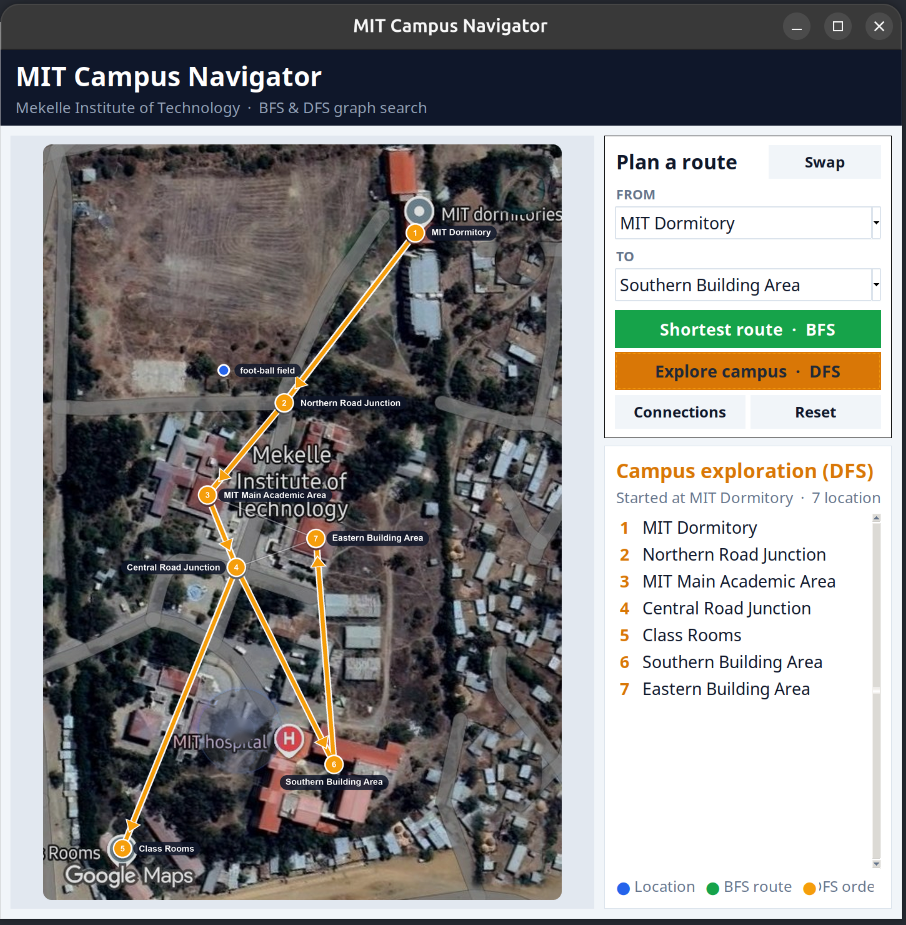

<div align="center">

# MEKELLE UNIVERSITY

## MEKELLE INSTITUTE OF TECHNOLOGY

### Artificial Intelligence (AI)

**Project Title**

# Real-World Problem Solving via BFS and DFS

</div>

---

## Group Members Information

| No. | Group Member Name | Student ID |
|:---:|-------------------|------------|
| 1 | Abel Adhanom | MIT/UR187791/16 |
| 2 | Fikadu Gebremedhin | MIT/UR188115/16 |
| 3 | Selemun Welegebrial | MIT/UR188651/16 |
| 4 | Mulugeta Teamrat | MIT/UR190604/16 |
| 5 | Tsegay Araya | MIT/UR188761/16 |
| 6 | Gebrekiros Gebrezgiher | MIT/UR190719 |

**Submitted to:** Mr. Wudasie Gereziher  
**Submission Date:** 27 November 2026

---

# MIT Campus Navigator (BFS & DFS)

## Project Overview

MIT Campus Navigator is a small Artificial Intelligence course project developed to solve a real-world navigation problem: finding routes and exploring locations within the Mekelle Institute of Technology campus.

The project represents the campus as a graph and applies two fundamental graph-search algorithms, Breadth-First Search (BFS) and Depth-First Search (DFS), to navigate and explore campus locations.

## Algorithms Used

| Algorithm | Description |
|-----------|-------------|
| **Breadth-First Search (BFS)** | Finds the shortest path between two campus locations in terms of the number of edges (steps), assuming all connections have equal cost. |
| **Depth-First Search (DFS)** | Explores the graph by visiting nodes as deeply as possible before backtracking. |

The campus is modeled as a graph containing **7 locations (nodes)** and **8 connections (edges)**, visualized using satellite map imagery.

---

## BFS – Shortest Route

Breadth-First Search (BFS) is used to find the shortest route between a selected starting location and a destination. It explores the graph level by level, visiting nearby nodes before moving farther away.

In this application, the BFS-generated route is displayed in **green**, with numbered markers representing the order of locations along the shortest path.

### BFS Result

The screenshot below shows the shortest route from MIT Dormitory to Class Rooms using BFS.



*Figure 1: Shortest route generated using Breadth-First Search (BFS), highlighted in green.*

---

## DFS – Campus Exploration

Depth-First Search (DFS) is used to explore campus locations starting from a selected node. It follows one path as deeply as possible before backtracking to explore other connected locations.

In this application, the DFS exploration order is displayed in **yellow/orange**, with numbered markers showing the sequence in which locations are visited.

### DFS Result

The screenshot below shows the campus exploration process starting from MIT Dormitory using DFS.



*Figure 2: Campus graph exploration using Depth-First Search (DFS), highlighted in yellow/orange.*

---

## Installation and Execution

### Requirements

- Python 3
- pip

### Installation

Install the required dependencies:

```bash
pip install -r requirements.txt
